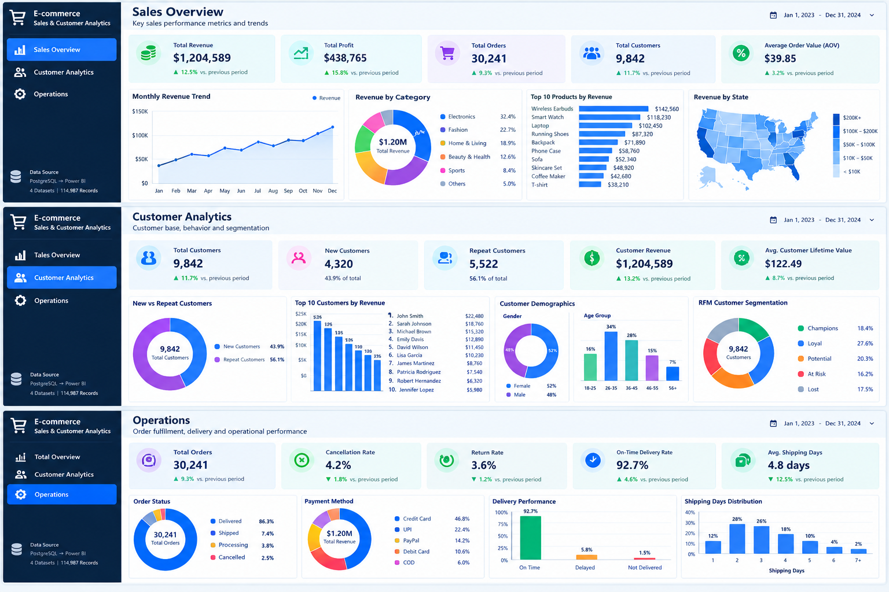

# E-commerce Sales & Customer Analytics

An end-to-end analytics project analyzing **sales, customers, products, and order operations** using Python, PostgreSQL, SQL, and Power BI.

## 📊 Dashboard Preview



> Dashboard preview created for the project. Interactive Power BI `.pbix` dashboard will be added in a future update.

## 🛠️ Tech Stack

- **Python** — Pandas, data cleaning & EDA
- **PostgreSQL** — relational database
- **SQL** — business analysis & KPIs
- **Power BI** — dashboard visualization
- **Git & GitHub** — version control

## 📊 Dataset

- 10,000 Customers
- 498 Products
- 30,000 Orders
- 74,485 Order Items
- Data covering 2024–2025

## 🔍 Analysis

- Revenue & profit analysis
- Monthly sales trends
- Product & category performance
- Customer purchase behavior
- One-time vs repeat customers
- RFM customer segmentation
- Customer lifetime value
- Cancellation & return analysis
- Payment method analysis
- Delivery & shipping performance
- Regional sales analysis
- Discount & profitability analysis

## 🗄️ PostgreSQL

Database: `ecommerce_analytics`

Tables:

```text
customers
products
orders
order_items

SQL analysis includes 24 business questions and KPI queries.

📈 Key Results
Metric	Value
Revenue	₹1.42B
Profit	₹243.06M
Profit Margin	17.14%
Orders	30,000
Customers	10,000
Products	498
AOV	₹47,257.62
🔄 Workflow
Raw Data → Python/Pandas → PostgreSQL/SQL → Power BI
📁 Project Structure
data/         → Raw datasets
python/       → Data generation & EDA
sql/          → Schema & business analysis
powerbi/      → Power BI-ready datasets
screenshots/  → Dashboard preview
🚀 Future Work
Build interactive Power BI .pbix dashboard
Add advanced DAX measures
Automate data refresh
Explore AWS-based deployment
👩‍💻 Author

Saheba Bagwan
IT Engineering Graduate | Aspiring Cloud & DevOps Engineer | Data Analytics Enthusiast
